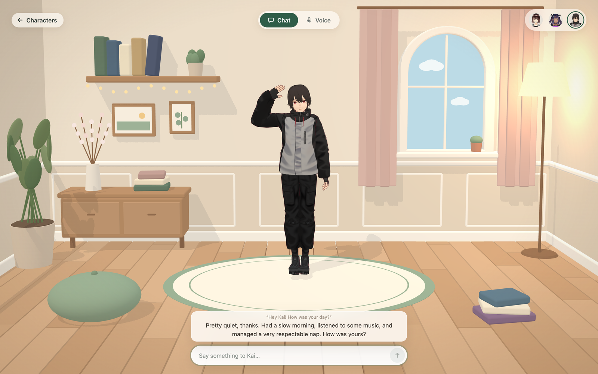
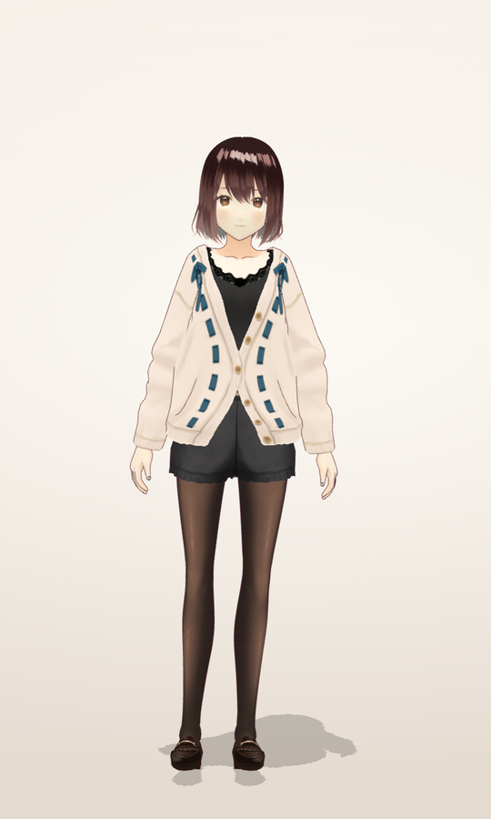
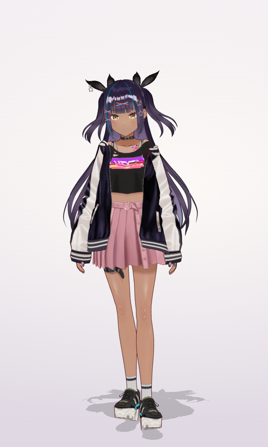
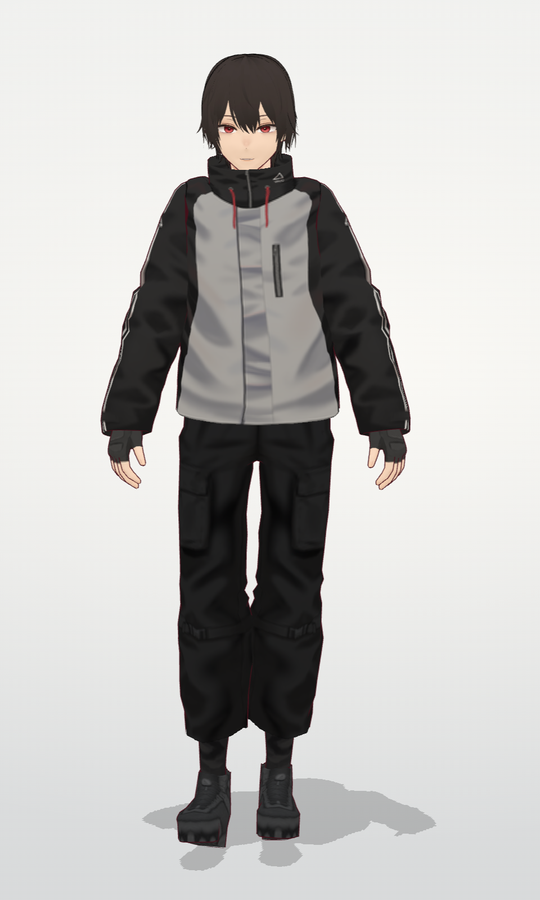
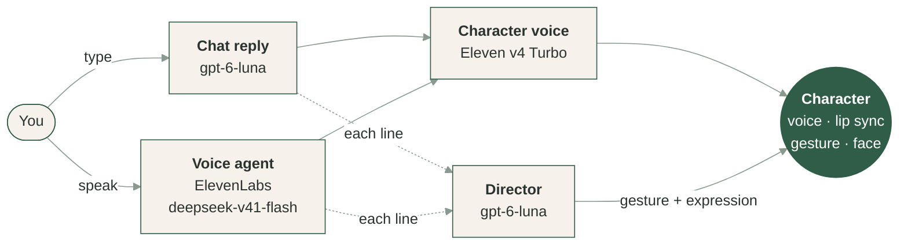

<p align="center">
  
</p>

<h1 align="center">Anima</h1>

<p align="center">
  <strong>Anime characters that feel alive, right in your browser.</strong><br>
  Chat with them or just talk out loud. They answer in their own voice,<br>
  move while they speak and react to what you say.
</p>

<p align="center">
  <a href="https://github.com/Yun-0000/Anima/releases"></a>
  <a href="LICENSE"></a>
  
  
  
  
</p>

<p align="center">
  <a href="#quick-start"><b>Quick start</b></a>
  &nbsp;·&nbsp;
  <a href="#voice-mode"><b>Voice mode</b></a>
  &nbsp;·&nbsp;
  <a href="#how-it-works"><b>How it works</b></a>
  &nbsp;·&nbsp;
  <a href="#roadmap"><b>Roadmap</b></a>
</p>

<br>

<table align="center">
  <tr>
    <td align="center" width="33%"></td>
    <td align="center" width="33%"></td>
    <td align="center" width="33%"></td>
  </tr>
  <tr>
    <td align="center"><b>Mio</b><br><sub>Gentle, thoughtful, a little shy.<br>Reads everything from poetry to field guides.</sub></td>
    <td align="center"><b>Rin</b><br><sub>Cool, playful, a little mischievous.<br>Teases you, and loves to be teased back.</sub></td>
    <td align="center"><b>Kai</b><br><sub>Calm, easygoing, fond of naps.<br>Slow mornings and quiet music.</sub></td>
  </tr>
</table>

## Highlights

<table>
  <tr>
    <td width="33%" valign="top">
      <h3>Talk out loud</h3>
      Press the microphone and speak. The character answers in under a second, in your language, and you can cut in at any time.
    </td>
    <td width="33%" valign="top">
      <h3>One voice each</h3>
      Every character keeps the same ElevenLabs voice in Chat and in Voice mode.
    </td>
    <td width="33%" valign="top">
      <h3>A director for the body</h3>
      A small model reads every line, yours and theirs, and decides when to wave, nod, shake the head or shrug, and which face to make.
    </td>
  </tr>
  <tr>
    <td valign="top">
      <h3>Natural motion</h3>
      Motion-capture idles, talk, wave and shrug, retargeted onto each VRM, with blinking, breathing and a slow shift of weight.
    </td>
    <td valign="top">
      <h3>A room of their own</h3>
      A small, warm room seen from one fixed camera. Left alone, the characters idle, look at your pointer and now and then doze off.
    </td>
    <td valign="top">
      <h3>Works without keys</h3>
      With no keys, the rooms, characters and motions all work and replies are scripted. Add your own keys for real conversation.
    </td>
  </tr>
</table>

## Quick start

You need **Python 3.12** and **Node 20+**.

```bash
# Backend
cd backend
python3.12 -m venv .venv
.venv/bin/python -m pip install -r requirements.txt
cp .env.example .env
.venv/bin/python -m uvicorn app.main:app --port 8001
```

```bash
# Frontend, in a second terminal
cd frontend
npm install
npm run dev
```

Open **http://127.0.0.1:4173**, pick a character and say hi.

### Keys

Keys are your own and stay in `backend/.env`. The browser never sees them.

| In `backend/.env` | Unlocks |
| :--- | :--- |
| *nothing* | Rooms, characters and motions, with scripted replies |
| `OPENAI_API_KEY` | Real replies (`gpt-6-luna`) and the gesture director |
| `ELEVENLABS_API_KEY` | Each character's voice in Chat |
| `ELEVENLABS_AGENT_ID` | Voice mode, see below |

## Voice mode

Voice mode runs on an ElevenLabs voice agent. Give your ElevenLabs key the ElevenAgents read and write permissions, then create the agent once:

```bash
backend/.venv/bin/python scripts/setup_voice_agent.py
```

Add the `ELEVENLABS_AGENT_ID` it prints to `backend/.env` and restart the backend. In a room, choose **Voice**, press the microphone and talk. Press it again to stop.

> [!NOTE]
> One agent serves every character: each session sends the character's prompt and voice. The backend only hands the browser a one-time token, and the audio goes over WebRTC between your browser and ElevenLabs. A session ends after a minute of silence, after ten minutes at most, or when you leave the room or switch to Chat.

> [!TIP]
> Voice mode is tested in desktop Chrome. Allow the microphone when the browser asks.

## How it works



- **Talking and body language are separate.** The reply model only talks. The director (`/api/direct`) picks a gesture (usually none) and an expression for each line, so the body acts the same way in both modes.
- **The stage** (`frontend/src/stage/`) renders the room with three.js and three-vrm: motions retargeted onto each VRM, feet kept on the floor, soft blends between motions and a camera framed for each screen size.
- **The backend** (`backend/app/`) is a small FastAPI app for chat replies, streamed speech, voice session tokens and the director. Character personas live in `backend/app/prompts/character_prompt.py`.

<details>
<summary><b>Project layout</b></summary>

```text
backend/                 FastAPI: chat, speech, voice sessions, director
frontend/                React + Vite: intro, characters, rooms, /lab
  public/models/         the three VRM characters
  public/motions/        bundled motions
scripts/
  setup_voice_agent.py   creates or updates the ElevenLabs voice agent
  compress_vrm.py        shrinks a VRM without changing its look (needs numpy and Pillow)
```

Open http://127.0.0.1:4173/lab to check characters, motions and expressions, or drop a `.vrm` or `.glb` file onto the page to try it. Motions are listed in `frontend/src/stage/catalog.ts` and characters in `frontend/src/characters/catalog.ts`.

</details>

<details>
<summary><b>Development</b></summary>

```bash
cd frontend && npm test -- --run && npm run lint && npm run build
cd backend && .venv/bin/python -m pytest
```

</details>

<details>
<summary><b>Troubleshooting</b></summary>

- **Voice is greyed out:** set `ELEVENLABS_API_KEY` and `ELEVENLABS_AGENT_ID` in `backend/.env` and restart the backend.
- **"Could not reach the Anima server":** the backend is not running on port 8001.
- **Microphone blocked:** allow it in the browser's site settings, then press the microphone again.

</details>

## Roadmap

- [x] Three characters with their own personalities and voices
- [x] A natural, bundled motion set
- [x] Live voice, with body language directed separately from speech
- [ ] A hosted demo
- [ ] Memory across visits
- [ ] More rooms and times of day

## License

Code is MIT licensed. The characters are VRoid's freely licensed sample avatars. See [ASSET_LICENSE.md](ASSET_LICENSE.md) for characters and motions and [THIRD_PARTY_NOTICES.md](THIRD_PARTY_NOTICES.md) for bundled libraries.
